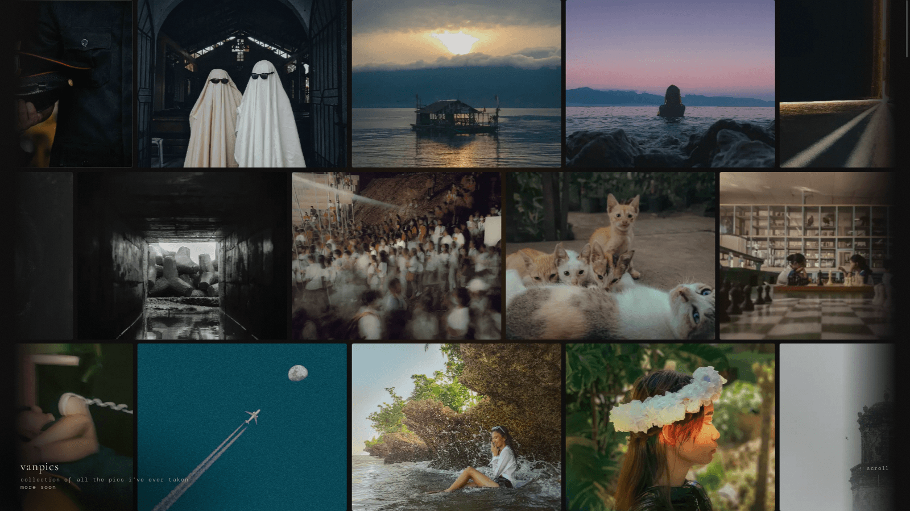
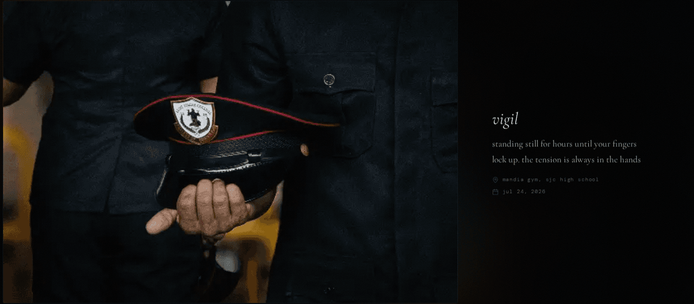

# vanpics-portfolio

my photography & motion portfolio. minimal, typographic, smooth.

[**live site: vanpics.pages.dev**](https://vanpics.pages.dev)

<!-- TODO: HERO SHOT. full-width screenshot of the homepage with the masonry grid (1600px wide is plenty). save as docs/hero.png -->

## why this exists

google photos felt too impersonal for the pictures i actually care about. so i built a place where every photo gets a caption that works like a scrapbook page: sometimes a full diary entry about how and why i took it, sometimes just a vague one-liner. the site is built around that, not just around showing images.

## what it does

- **masonry grid gallery** with category filtering
- **custom lightbox** with thumbnail hand-off and filmstrip nav
- **pre-calculated aspect ratios** so nothing jumps around on load
- **swipe gestures** on mobile
- **blurred glass backgrounds** in the lightbox, generated from the photo's own thumbnail

### demo

<!-- TODO: once you record screen clips, drop them in docs/ and uncomment:

-->

## stack

- html / css / vanilla js
- [vite](https://vitejs.dev/) for the dev server and static production build
- node + [sharp](https://sharp.pixelplumbing.com/) for image processing
- hosted on cloudflare pages
- fonts: cormorant garamond & dm mono

dev: `npm install && npm run dev`

<!-- TODO: if the darkroom CMS (workers, d1, r2) or the webgl effects live in this repo, add them to the list above. if they live elsewhere, link that repo here. delete this comment either way -->

## license

photos © francis evan. all rights reserved. don't use them without asking.

<!-- TODO: pick a license for the code (MIT is the usual move) and add a LICENSE file, then add a line like "code: MIT" here -->
